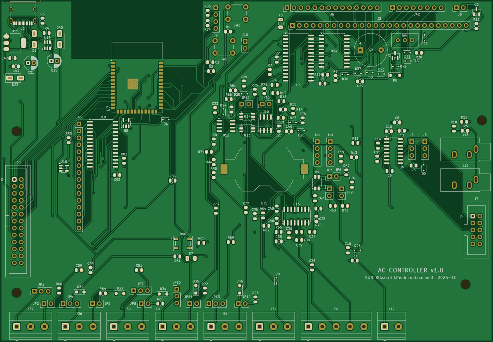
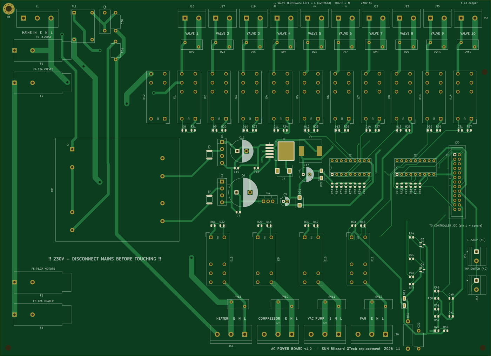

# Blizzard QTech replacement controller

An open-source replacement main board for the **SUN (Snap-on) Blizzard QTech2** vehicle air-conditioning service machine.

The original controller (NXP LPC2148) failed in my machine: it powered up and clicked its relays, but the display only showed blocks and the buttons did nothing. Every other part of the machine — valves, compressor, vacuum pump, scale, sensors — still worked. Rather than scrap a working machine for one dead board, I designed a new controller from scratch that plugs into the original wiring harness.

> ⚠️ **Mains voltage.** The power board switches 230 V AC to the compressor, heater and valves. Only build, test or install it if you are competent to work on mains equipment. Disconnect the supply before touching anything. The machine also handles pressurised refrigerant — follow F-gas rules.

> Not affiliated with, endorsed by or supported by Snap-on or SUN. "SUN", "Snap-on" and "Blizzard" are used only to describe what this board is compatible with.

| Controller board (v3, 4-layer) | Power & relay board (v1.1, 2-layer) |
|---|---|
|  |  |

## How it's built

The design is split across **two boards joined by a 26-way ribbon cable**, so the low-voltage logic and the mains switching are kept apart. Either board can be repaired or replaced on its own.

```
                 ┌──────────────────────────┐   ribbon (J30)   ┌───────────────────────────┐
  keypad ───────►│     CONTROLLER BOARD     │◄────────────────►│   POWER & RELAY BOARD     │──► 10 × solenoid valves
  LCD    ◄───────│  ESP32-S3, sensors, I/O  │  relay drive,    │  230 V in, fused outputs  │──► compressor, vac pump
  sensors ──────►│  watchdog, RTC, FRAM     │  12 V, SAFE_EN,  │  transformer, 12 V / 5 V  │──► tank heater, fan
  printer ◄──────│                          │  E-stop, HP sw.  │  relays + varistors       │◄── E-stop, HP switch
                 └──────────────────────────┘                  └───────────────────────────┘
```

### Controller board (v3)

4-layer, 180 × 125 mm.

| Function | Part |
|---|---|
| Microcontroller | ESP32-S3-WROOM-1 (N8 or N16R8) — Wi-Fi, USB-C programming with ESD protection |
| Display | Original 14-pin HD44780 character LCD, via a 74HCT245 level shifter; backlight on a MOSFET |
| Keypad | Original keypad, scanned through an MCP23017 I/O expander |
| Pressure | 5 inputs for 0.5–4.5 V transducers (high side, low side, 2 × manifold, spare), each with TVS protection and a jumper-selectable sensor supply |
| Temperature | Tank NTC thermistor |
| Refrigerant scale | NAU7802 24-bit load-cell ADC |
| Current sensing | 2 × 3.5 mm jacks for CT clamps (compressor, vacuum pump) |
| Monitoring | 12 V and 5 V rail monitors, leak sensor — 3 × ADS1115 16-bit ADCs |
| Storage | MB85RC256V FRAM (32 KB) for settings and logs |
| Clock | DS3231M real-time clock with CR2032 backup |
| Safety | TPS3823 hardware watchdog AND-ed with a GPIO to produce `SAFE_EN` — if the firmware hangs, every output drops out |
| Printer | Original printer port, RS-232 (MAX3232) or TTL, jumper selectable |
| Extras | Buzzer, WS2812B status LED, second MCP23017 for expansion |

### Power & relay board (v1.1)

2-layer, 272 × 198 mm, 1 oz copper.

| Function | Detail |
|---|---|
| Mains input | EMI filter choke, X2/Y2 safety capacitors |
| Supplies | Hahn UI39 PCB transformer (reused from the original board) → bridge rectifiers → LM2937 12 V linear and LM2596 5 V buck regulators |
| Fusing | Separate 5×20 mm fuses for the transformer (T125 mA), valves (T2 A), motors (T6.3 A) and heater (T2 A); resettable fuses on the low-voltage side |
| Valve outputs | 10 × 230 V outputs for the Parker YB14 solenoid coils (14 W), each with a varistor |
| Motor outputs | Compressor (1/3 HP), vacuum pump and fan, with larger varistors |
| Heater output | 230 V, 230 W tank heater (optional parts — leave out if the machine has no heater) |
| Relays | 12 V coil relays driven by 2 × ULN2803A, with an LED per output. Footprints for Omron G2RL, plus the original Panasonic JW1FSN / ALZ22B12 relays reused from the old board |
| Safety inputs | E-stop and high-pressure switch (both normally closed) |
| Wiring | 7.62 mm mains screw terminals, labelled for each valve and motor |

Bills of materials: [controller](hardware/controller-board/BOM.csv) · [power board](hardware/power-board/BOM.csv) · [cable and extras](hardware/BOM_extras.csv)

## Repository layout

```
firmware/
  bench-test/AC_Controller_Test/   Bench-test firmware for the controller board
hardware/
  controller-board/                KiCad 10 project, BOM, gerbers (fabrication/), 1:1 fit-check print
  power-board/                     KiCad 10 project, BOM, gerbers, custom footprints and 3D models
  BOM_extras.csv                   Ribbon cable, jumpers and other loose parts
docs/images/                       Board renders
```

Open the `.kicad_pro` files in **KiCad 10** or newer. The gerber zips in each `fabrication/` folder can be uploaded to JLCPCB as they are.

## Bench-test firmware

[`firmware/bench-test`](firmware/bench-test/AC_Controller_Test/AC_Controller_Test.ino) checks a freshly built controller board on its own, powered from USB-C — no power board or mains needed. It uses no external libraries.

On power-up it runs automatic tests and shows the result on the LCD and status LED:

- Finds every I²C device (I/O expanders, ADCs, load-cell ADC, FRAM, RTC)
- FRAM write/read-back and boot counter
- RTC ticking and temperature
- 5 V, 12 V and sensor supply rails
- Load-cell ADC, Wi-Fi scan

Then a serial menu for hands-on tests: live sensor readings, keypad mapping, walking each relay output, backlight/buzzer/LED, the watchdog and `SAFE_EN` cut-out, printer-port loopback, load-cell readings and setting the clock.

**Arduino IDE setup:** board *ESP32S3 Dev Module*, *USB CDC On Boot: Enabled*, flash and PSRAM to match your module. Full steps are at the top of the sketch.

## Status

| Part | Status |
|---|---|
| Controller board v3 | ✅ Built and hand-soldered |
| Bench-test firmware | ✅ Written |
| Power & relay board v1.1 | 🛠️ Design finished, gerbers ready |
| Machine control firmware | 🔜 Next |

## Licence

- Firmware (`firmware/`): [MIT](LICENSE)
- Hardware (`hardware/`): [CERN-OHL-P v2](LICENSE-HARDWARE)
